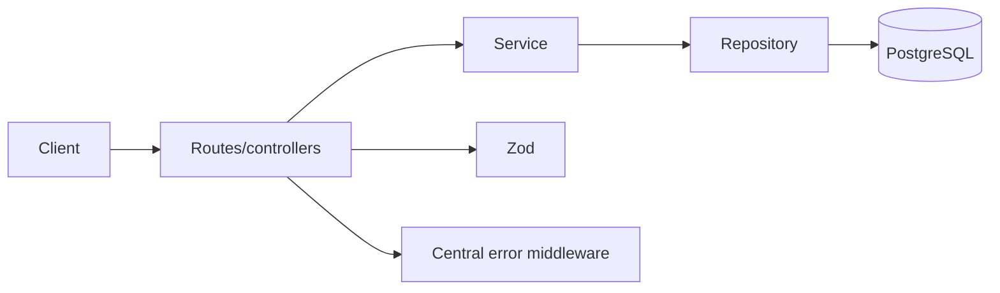
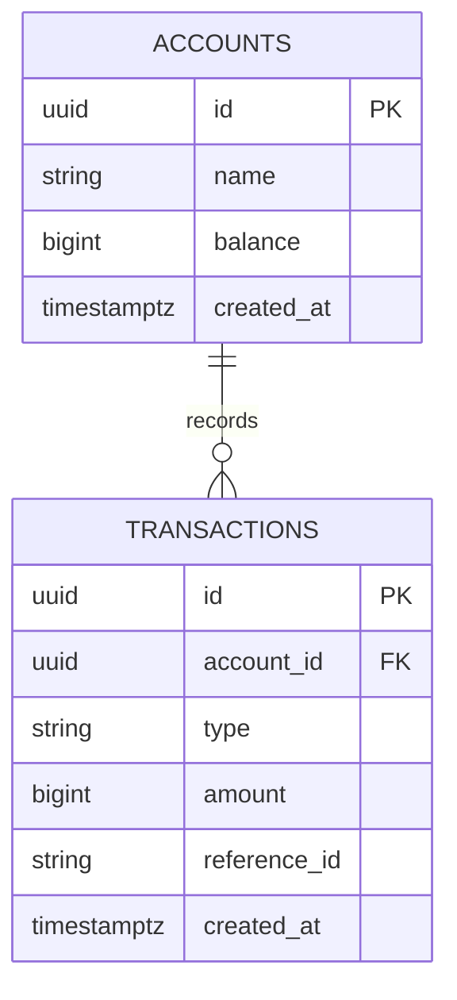
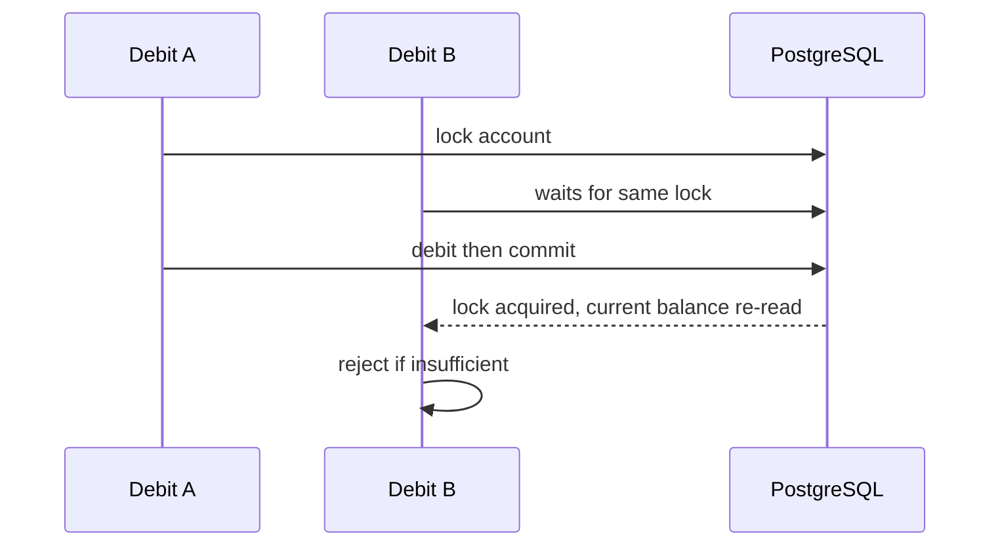

# Architecture



Controllers in `src/controllers` translate HTTP only. Services own business decisions; repositories in `src/repositories` contain SQL. `src/config/database.js` owns connection pooling and transaction boundaries.



`migrations/001_initial.sql` constrains nonblank names, nonnegative balances, positive amounts, allowed types, foreign keys, and account/reference uniqueness. The history indexes support account/type filtering and descending time/id order.

## Transaction sequence

```mermaid
sequenceDiagram
Client->>Service: credit/debit
Service->>PG: BEGIN
Service->>PG: SELECT account FOR UPDATE
PG-->>Service: serialized account row
Service->>Service: check funds; calculate cents
Service->>PG: UPDATE accounts balance
Service->>PG: INSERT transactions
Service->>PG: COMMIT
```

Any error causes `ROLLBACK`. The account lock makes concurrent balance modifications wait, so the next request reads the committed balance. The unique constraint resolves duplicate references even across processes; its 23505 error is mapped only after the failed transaction has rolled back.



Account balance is a committed projection of ledger history. Application routes cannot edit/delete rows, but strict database immutability would additionally require permissions or triggers.
