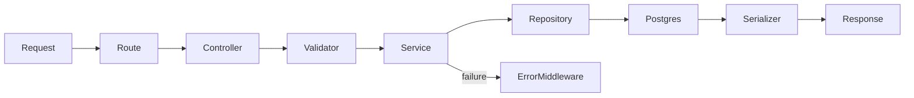

# Learning guide: designing a ledger API

This project turns a deceptively simple requirement—“add money and spend money”—into a reliable backend. Start by writing invariants, not routes: a new account is zero; every amount is positive; balance never falls below zero; an entry belongs to an account; an account/reference pair is processed once. Those become request validation, service rules, and database constraints. Using all three matters: browser input can be malformed, services can contain bugs, and concurrent application instances can bypass memory-only checks.

## 1. Translate requirements into HTTP contracts

Resources are accounts and their transactions. `POST /api/v1/accounts` creates (201), `GET .../balance` reads (200), and `POST .../transactions` appends a ledger record (201). A missing resource is 404, malformed request is 400, and a valid request that conflicts with current state is 409. DTOs in `src/utils/serializers.js` deliberately expose selected fields rather than PostgreSQL rows.

For example, account creation accepts only `{name}`. `accountSchema` is `.strict()`, so `{name:"Ada",balance:"999"}` is 400: protected financial fields are never silently ignored. `transactionSchema` separately checks structure, while `transaction.service.js` decides whether a debit is affordable. This distinction makes client corrections clear.

## 2. Express structure and request lifecycle

`src/app.js` composes JSON parsing, health, Swagger, routes, 404 handling, and the one error handler. `src/server.js` only opens the port, which lets Supertest use the app without a network listener. Routes call controllers; `asyncHandler` forwards rejected promises; controllers validate and serialize; services implement rules; repositories issue SQL. That separation prevents an Express request object or SQL syntax from leaking into the business model.

Avoid putting the debit algorithm in a controller: it would become hard to test outside HTTP, reuse, or protect with a transaction.

## 3. Schema, migrations, and indexes

`migrations/001_initial.sql` is the authoritative schema. A migration is a versioned, repeatable record of database change; `scripts/migrate.js` records applied filenames in `schema_migrations`. It never runs destructive “sync”. `accounts.balance BIGINT CHECK (balance >= 0)` is cents. `transactions.amount BIGINT CHECK (amount > 0)` prevents invalid rows even if application code is bypassed. The foreign key preserves referential integrity and the unique `(account_id, reference_id)` is the idempotency backstop. Descending account/time/id indexes let PostgreSQL page history rather than loading every row.

## 4. Exact money

JavaScript `0.1 + 0.2` is not reliably `0.3`; binary floating point is wrong for ledger arithmetic. `parseMoney` in `src/utils/money.js` requires a decimal string like `"100.25"`, then removes the dot and creates `10025n`. `BigInt` arithmetic is exact. `formatMoney` restores the API string. Inputs with a third fractional digit, zero, negatives, exponent notation, and numbers are rejected—there is no hidden rounding. PostgreSQL stores the same minor units in `BIGINT`. This design assumes one two-decimal currency; a multi-currency system needs currency codes and scale rules.

## 5. ACID and concurrency

ACID means the transaction is all-or-nothing (atomic), respects constraints (consistent), hides intermediate changes appropriately (isolated), and survives commit (durable). In `transactionService.create`, `withTransaction` sends `BEGIN`; `accountRepository.lock` issues `SELECT ... FOR UPDATE`; only then does code read balance and decide whether the debit fits. It updates the account, inserts its immutable transaction, and `withTransaction` commits. A thrown error performs `ROLLBACK` before releasing the connection.

Two debits that each look affordable can otherwise both read the same value and overdraw. With a row lock, the second waits, rereads after the first commit, and rejects if necessary. A database transaction alone without the lock would not guarantee this at PostgreSQL’s usual isolation level.

## 6. Idempotency and failed transactions

Clients retry when a timeout hides whether a request arrived. `reference_id` is a client operation key scoped to one account. The unique constraint permits different accounts to use `invoice-1`, but only one ledger entry for an account/invoice pair. The first request returns 201; a duplicate gets 409 `DUPLICATE_REFERENCE`.

PostgreSQL marks a transaction failed after a unique violation. Therefore this implementation does not query for a duplicate after the failed insert: the transaction wrapper rolls back, then centralized middleware maps SQLSTATE `23505`. This prevents both partial writes and “current transaction is aborted” mistakes. It is processing idempotency, not magical exactly-once network delivery or response replay.

## 7. Read paths: filtering, ordering, pagination

`transactionRepository.list` filters in SQL, uses `ORDER BY created_at DESC, id DESC`, and applies `LIMIT/OFFSET`. The secondary ID ordering makes equal timestamps stable. `historySchema` uses zero-based pages, defaults 0/10, refuses negative pages and caps limits at 100. A count query builds response metadata. For very large histories, cursor pagination is usually preferable to deep offsets.

## 8. Errors, OpenAPI, and tests

`AppError` defines safe expected failures. `error-handler.js` maps known database uniqueness errors and hides SQL internals for unexpected errors. Swagger UI at `/docs` provides an OpenAPI entry point; [API_DOCUMENTATION.md](API_DOCUMENTATION.md) gives the complete human contract.

`tests/unit/money.test.js` tests deterministic monetary parsing without a database. `tests/integration/ledger.test.js` uses a real database when `RUN_INTEGRATION_TESTS=true`; it verifies credit/debit behavior, rollback-like failure outcomes, duplicates, and concurrent debits. Real PostgreSQL matters here because mocks cannot prove lock and constraint behavior. Docker Compose provides the repeatable local database. A production suite could use Testcontainers to create an isolated database per test run.

## 9. Reusable workflow and interview prompts

For future APIs: list invariants; map them to HTTP/service/database layers; write migrations; implement a thin vertical slice; add failure/concurrency tests; document what is database-specific; then add optional features. Common questions: “Why not calculate balance each read?” Persisted balances make reads cheap, but require atomic updates. “Why row locks?” They serialize dependent read-modify-write operations. “Why unique constraints as well as validation?” Constraints protect all writers and racing requests. “Why no DELETE?” Ledgers need audit history; a real system might post compensating entries and enforce database permissions/triggers.

Transfers are intentionally absent rather than superficial. A correct version would lock both accounts in UUID order, add a transfer table with a globally unique reference, append matching debit/credit records, update both balances, and commit everything together. Transfer-level idempotency would be global to the transfer reference—not the per-account transaction constraint used here.
